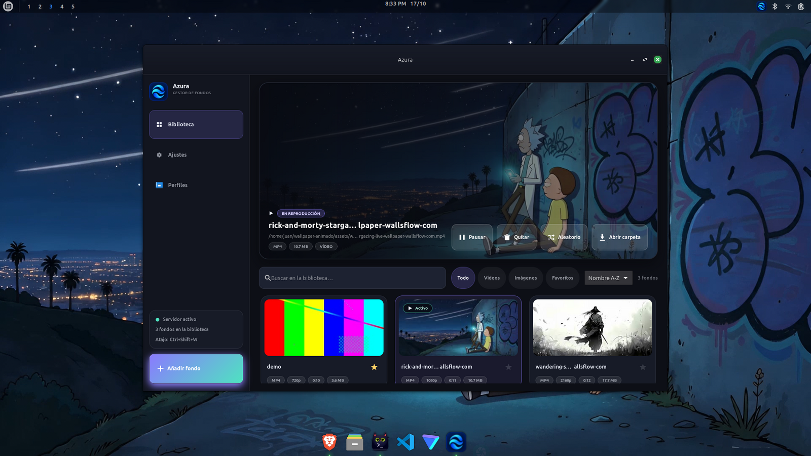

<h1> Azura</h1>

**Gestor de fondos de pantalla animados para Linux (X11).** Vídeos e imágenes
como fondo de escritorio, con biblioteca propia, miniaturas y bandeja del
sistema. Cada fondo se reproduce con `mpv` situado al nivel del escritorio,
por debajo de las ventanas normales.


<p align="center">
  
</p>

## ✨ Características

- 🎞️ **Vídeos e imágenes**: mp4, webm, mkv, mov, gif, png, jpg y jpeg.
- 📚 **Biblioteca**: importar (copiando o con enlace simbólico), buscar, filtrar
  por tipo, favoritos, etiquetas y ordenación personalizada.
- 🖼️ **Miniaturas automáticas** de cada fondo de la biblioteca.
- 🔍 **Metadatos**: resolución, duración, fps y códec de cada fondo.
- ▶️ **Vista previa** integrada antes de aplicar un fondo, con controles de
  pausa, etiquetas, cerrar y aplicar.
- 🔁 **Cambio automático** de fondo con intervalo configurable y orden aleatorio.
- 🚧 **Perfiles** *(en desarrollo)*: guarda tu combinación de temas del sistema
  (GTK, ventanas y Cinnamon), la configuración de `fastfetch` y la de `kitty`
  en un perfil con nombre, y aplícala cuando quieras.
- 😴 **Pausa inteligente**: al entrar en pantalla completa, con batería, al
  cambiar de aplicación o de espacio de trabajo, con la pantalla bloqueada y
  por inactividad.
- 🎛️ **Límite de FPS** para reducir el consumo de GPU.
- 🖥️ **Multi-monitor**: un fondo global o uno distinto por pantalla.
- ⌨️ **Atajos globales** configurables para abrir el menú y cambiar de fondo.
- 🔔 **Notificaciones** al cambiar de fondo.
- 💻 **Línea de comandos** para controlar todo desde la terminal.
- 📦 **Bandeja del sistema**: menú, aleatorio, siguiente, pausar y salir.

## 📋 Requisitos

- Linux con **X11** (Wayland no está soportado).
- `mpv` y `ffmpeg` en el `PATH`.
- Para compilar: Rust estable y las dependencias de desarrollo de GTK4.

```bash
# Debian/Ubuntu
sudo apt install mpv ffmpeg libgtk-4-dev
# Arch
sudo pacman -S mpv ffmpeg gtk4
```

Probado en Linux Mint 22.3 (Cinnamon, X11).

## 🔨 Compilación

```bash
git clone https://github.com/Juanes767/azura.git
cd azura
cargo build --release
```

## 🚀 Uso

```bash
./run.sh          # compila si hace falta e inicia el daemon en primer plano
```

Abre el menú con el binario `wallpaper-menu`, con el lanzador del escritorio o
con el atajo global (`Ctrl+Shift+W` por defecto). Si el servidor no está en
ejecución, el menú muestra el botón **Iniciar servidor**.

### 💻 Línea de comandos

```bash
wallpaper-animado status          # estado del servidor
wallpaper-animado next            # siguiente fondo
wallpaper-animado random          # fondo aleatorio
wallpaper-animado set ~/fondo.mp4 # aplicar un fondo concreto
wallpaper-animado pause           # pausar / resume para reanudar
wallpaper-animado open            # abrir el menú
wallpaper-animado quit            # detener el servidor
wallpaper-animado help            # ayuda completa
```

### ⚙️ Servicio de usuario (systemd)

```bash
./install-service.sh
systemctl --user status wallpaper-animado   # estado
journalctl --user -u wallpaper-animado -f   # registros
```

El instalador además crea el lanzador «Azura» en el menú de aplicaciones,
instala el icono y enlaza el comando `wallpaper-animado` en `~/.local/bin`.

También se puede activar **Iniciar con la sesión** desde Ajustes.

## ⌨️ Atajos

Presets disponibles (Ajustes → Atajos) para **abrir el menú** y para
**siguiente fondo**:

| Atajo         |
| ------------- |
| Ctrl+Shift+W  |
| Ctrl+Alt+W    |
| Super+W       |
| Ctrl+Alt+F12  |
| Ninguno       |

El daemon intenta registrar el atajo elegido; si ya está en uso, prueba los
demás y reporta el que quedó activo en la interfaz.

## 🖥️ Multi-monitor

En Ajustes se puede fijar un fondo distinto por monitor. El selector
**Pantalla** del destacado indica el destino al aplicar:

- **Todos**: fondo global (limpia los fondos por monitor).
- **Nombre del monitor**: solo esa pantalla.

El cambio automático respeta los fondos ya fijados por monitor.

## 🚧 Perfiles (en desarrollo)

> Esta función sigue en desarrollo: puede cambiar en próximas versiones.

La página **Perfiles** de la barra lateral guarda tu personalización actual y
la restaura cuando quieras:

- **Temas del sistema**: tema GTK, tema de ventanas y tema del escritorio
  (Cinnamon).
- **fastfetch**: tu configuración de `fastfetch`.
- **kitty**: tu `kitty.conf`; al aplicar el perfil, kitty recarga su
  configuración al instante.

Guardar con un nombre que ya existe pide confirmación para reemplazarlo, y
eliminar un perfil también pide confirmación.

## 📁 Rutas

| Qué | Dónde |
| --- | ----- |
| Configuración | `~/.config/wallpaper-animado/config.json` |
| Perfiles | `~/.config/wallpaper-animado/perfiles` |
| Biblioteca | `~/wallpaper-animado/assets/wallpapers` (o `$WALLPAPERS_DIR`) |
| Miniaturas | `~/.cache/wallpaper-animado/thumbs` |

## ⚠️ Limitaciones

- Solo X11: en Wayland el fondo no se puede anclar al escritorio.
- La función de **perfiles está en desarrollo** y puede cambiar.

## 📄 Licencia

Proyecto **open source** distribuido bajo la licencia [MIT](LICENSE).
